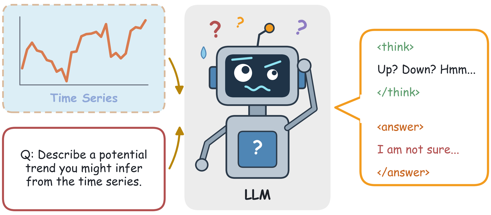
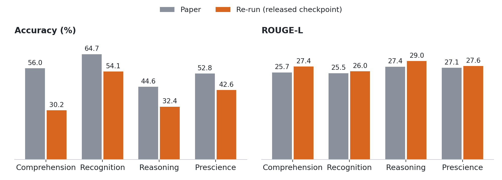
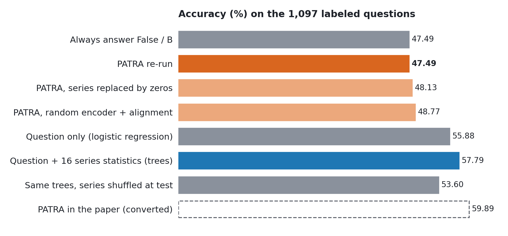
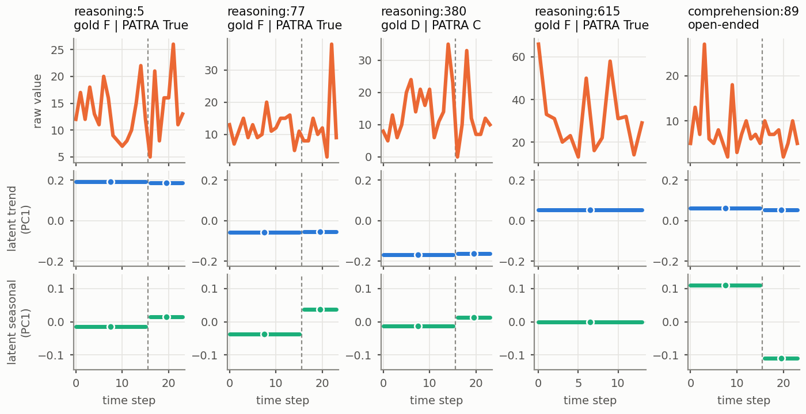
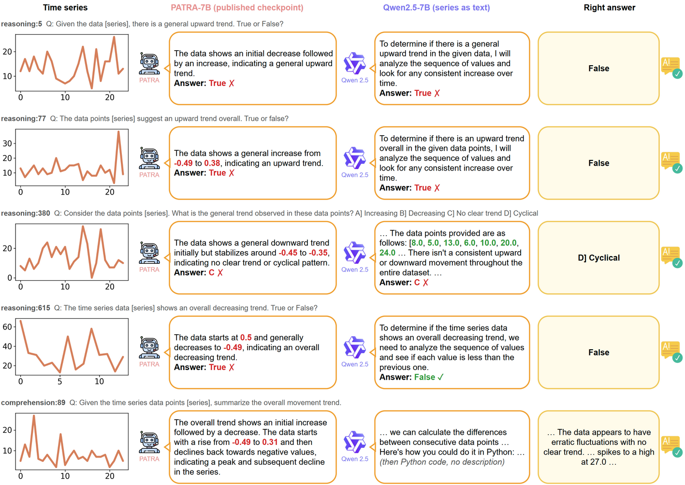

# A Self-Study of PATRA

Reproduction, code review and analysis of **PATRA: Pattern-Aware Alignment and Balanced Reasoning for Time Series Question Answering** ([Lu et al., ICML 2026](https://arxiv.org/abs/2602.23161)).



## 1. Reproduction



Re-run of both models, with paper values in parentheses:

| Task | PATRA-7B accuracy (%) | PATRA-7B ROUGE-L | Qwen2.5-7B accuracy (%) | Qwen2.5-7B ROUGE-L |
|---|---|---|---|---|
| Comprehension | 30.17 (56.03) | 27.39 (25.67) | 41.38 (42.24) | 18.74 (18.77) |
| Recognition | 54.07 (64.69) | 26.02 (25.46) | 48.83 (45.51) | 10.60 (10.32) |
| Reasoning | 32.43 (44.59) | 29.04 (27.36) | 29.73 (36.48) | 17.56 (18.72) |
| Prescience | 42.59 (52.78) | 27.55 (27.06) | 38.89 (26.85) | 10.96 (10.67) |

The setup used 1,097 labeled and 1,868 open-ended questions, run with greedy decoding on one GPU. Qwen2.5-7B reproduces the paper's ROUGE-L on every task. PATRA's accuracy is 10.19 to 25.86 points below the paper on every task. The best of four prompt and decoding variants reaches 52.05%.

## 2. Does PATRA read the series?



The code and weights explain why the series path has no effect:

| Finding | Evidence |
|---|---|
| **Alignment acts as an average** | Attention in the alignment module is near uniform: replacing it with a plain mean changes its output by 0.005%. After alignment, 98.12% of a series token is the same for every question. |
| **Training barely reaches it** | LoRA keeps the encoder and alignment weights frozen, whatever `--freeze_ts_encoder` says. GRPO with two samples per question gives near-binary advantages (±0.707). |
| **Quoted numbers are not grounded** | 94.25% of the numbers Qwen quotes (series given as text) occur in the raw series, against 3.44% for PATRA. Yet 77.02% of numbers in the training answers are raw values, which the normalized input hides from PATRA. |
| **ROUGE-L rewards wording** | One fixed sentence scores 21.21, above every baseline in the paper's Table 1. Flipping the trend direction in the gold answers still scores 94.49. |
| **A question-only shortcut exists** | A logistic regression that reads only the question reaches 55.88%, the same kind of artifact as hypothesis-only baselines in NLI. |

## 3. Case studies: volatile series

Evaluation series have at most 30 points, so they become only one or two 16-point patches, while the trend filter spans 25 patches (400 points). The latent trend and seasonality therefore collapse to one value per patch:



On the 287 most volatile evaluation series, PATRA gets 5 of 21 trend questions right. The report's main figure puts five of these failures next to the Qwen answer and the reference; green numbers occur in the series, red ones in neither the raw nor the normalized series:



All 21 trend questions, with one plot per series, are in [docs/case_study/CASE_STUDY.md](docs/case_study/CASE_STUDY.md). The selection is in [volatile_cases.json](results/analysis/volatile_cases.json) and the decomposition in [failure_decomposition.json](results/analysis/failure_decomposition.json).

## 4. Strengths, limitations and a proposal

- **Strengths:**
  - The paper names two concrete problems, weak grounding and task imbalance, and targets each with one component.
  - Its ablations isolate each part.
  - The authors released code, weights and data, which made this study possible.
- **Limitations:**
  - The model compresses each 16-point patch into one vector and fuses it with the question once, before generating, so it has no way back to the raw values.
  - The evaluation has no question-only baseline, and ROUGE-L rewards wording over correctness.
  - The release does not reach the paper's numbers, and the training code is incomplete.
- **Proposal: tool-augmented reasoning.**
  - While generating, the LLM can call tools on the raw series, such as `get_values(i, j)`, `trend(i, j)` or `extrema()`, and gets the results back as text it can quote and check.
  - Evaluate it with a question-only baseline, shuffled or zeroed series, and the share of grounded numbers.

## Reproduce

**GPU runs.** Open [notebooks/reproduce.py](notebooks/reproduce.py) in [molab](https://molab.marimo.io) (or run `uvx marimo edit --sandbox notebooks/reproduce.py` on a CUDA machine). Pick a run, press **Run**, then download the results zip and unpack it here. The notebook clones the upstream code (it has no license file, so it is not included in this repository), pins every revision and decodes greedily (`max_new_tokens=512`, batch size 1):

**CPU analysis.** Each script reads `results/` and writes to `results/analysis/` or `docs/`. The scripts that take `--cache-dir` share one download folder, so run them in this order:

```bash
pip install -r requirements.txt
python scripts/code_review_checks.py    --cache-dir ../patra_cache   # code-review evidence, number grounding
python scripts/benchmark_probes.py      --cache-dir ../patra_cache   # baselines that never read the series
python scripts/alignment_mechanics.py   --cache-dir ../patra_cache   # alignment recomputed on CPU (1.4 GB)
python scripts/failure_decomposition.py --cache-dir ../patra_cache   # latent decomposition, section 3
python scripts/case_study_figures.py                                 # volatile-series case studies
python scripts/readme_figures.py                                     # figures in this README
python report/check_numbers.py                                         # every number in the report
```

The report's main figure ([report/figures/failure_decomposition.pdf](report/figures/failure_decomposition.pdf)) was drawn by hand in draw.io from `failure_decomposition.json`. The smoke test and weight probe in `results/env/` and `results/analysis/` come from an earlier, longer version of the pipeline and are kept as records.


## Acknowledgements

This self study used code and data published by PATRA:

```bibtex
@inproceedings{lu2026patra,
  title     = {PATRA: Pattern-Aware Alignment and Balanced Reasoning for Time Series Question Answering},
  author    = {Lu, Junkai and others},
  booktitle = {ICML},
  year      = {2026}
}
```
