# PATRA trên chuỗi biến động mạnh (highly volatile)

Section 5.8 của paper nêu hạn chế khi xử lý "highly volatile, non-stationary sequences", minh họa bằng Fig. 5, chính là mẫu `reasoning:5` của PATRA-EVAL. File này tìm các chuỗi giống vậy trong lần chạy lại `patra__official` và đặt câu trả lời của PATRA cạnh đáp án đúng.

Sinh bởi [`case_study_figures.py`](../../scripts/case_study_figures.py) từ [`predictions.jsonl`](../../results/runs/patra__official/predictions.jsonl); số liệu trong [`volatile_cases.json`](../../results/analysis/volatile_cases.json).

## Cách chọn

- **Độ biến động** = trung bình |bước nhảy giữa hai điểm liên tiếp| chia cho độ lệch chuẩn của chuỗi. Chuỗi trơn có xu hướng rõ cho giá trị gần 0; nhiễu trắng khoảng 1.13.
- **Chuỗi biến động mạnh** = độ biến động từ phân vị 90 trở lên (≥ 1.00) trong 2,867 mẫu một chuỗi, dài từ 12 điểm. Có **287** chuỗi như vậy.
- `reasoning:5` có độ biến động 1.19, ở phân vị 96.8.
- **Về "non-stationary":** nếu đo bằng thay đổi giữa hai nửa chuỗi thì `reasoning:5` không nổi bật: tỷ lệ độ lệch chuẩn hai nửa 1.41 (phân vị 40.1), chênh trung bình 0.39 lần độ lệch chuẩn (phân vị 23.4). Vì vậy file này lọc theo độ biến động, còn tỷ lệ độ lệch chuẩn ghi trong bảng để tham khảo.

## Tóm tắt

| Nhóm câu có nhãn | Số câu | PATRA đúng | Accuracy |
|---|---|---|---|
| Câu về xu hướng, chuỗi biến động mạnh | 21 | 5 | 23.81% |
| Câu về xu hướng, các chuỗi còn lại | 143 | 46 | 32.17% |
| Mọi câu, chuỗi biến động mạnh | 110 | 60 | 54.55% |
| Mọi câu, các chuỗi còn lại | 920 | 431 | 46.85% |

Câu về xu hướng: câu hỏi chứa "trend", "direction", "general behavior" hoặc "overall movement". Chưa kiểm định thống kê; các nhóm nhỏ.

## Ghi chú

- Mọi câu trả lời lấy từ lần chạy lại `patra__official` (weight PATRA-7B công bố, prompt eval chính thức, greedy), không chép từ paper.
- Câu trả lời của `reasoning:5` trùng phần `<think>` trong Fig. 5 của paper; phần đáp án khác định dạng (`\boxed{True}` thay vì `<answer>True</answer>`).
- Accuracy chạy lại thấp hơn paper ở mọi task, nên các tỷ lệ trên mô tả bản công bố, không phải số trong paper.
- Phía dưới: 21 câu có nhãn về xu hướng trên chuỗi biến động mạnh (tất cả, không chọn lọc, xếp theo task và số dòng), rồi 3 câu mở chọn tay (chuỗi vừa biến động mạnh vừa đổi biên độ giữa hai nửa, tỷ lệ độ lệch chuẩn hai nửa từ phân vị 75 trở lên; ROUGE-L chỉ để tham khảo).

## `comprehension:626` · có nhãn

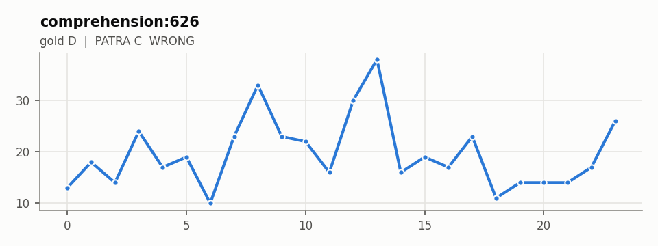

**Câu hỏi:** Summarize the general behavior of the series &lt;ts&gt;&lt;ts/&gt;. A] Steady increase B] Steady decrease C] Fluctuating with a rise at the end D] Fluctuating with no clear trend

**Đáp án đúng:** D

**PATRA:** C (wrong)

**Câu trả lời đầy đủ của PATRA:** &lt;think&gt;The series shows fluctuations without a clear upward or downward trend, indicating a fluctuating pattern with a rise towards the end.&lt;/think&gt; \boxed{C}

Độ biến động 1.02, độ dốc -0.01, tỷ lệ độ lệch chuẩn hai nửa 1.29. Chuỗi: 13, 18, 14, 24, 17, 19, 10, 23, 33, 23, 22, 16, 30, 38, 16, 19, 17, 23, 11, 14, 14, 14, 17, 26

## `reasoning:5` · có nhãn (Fig. 5 của paper)

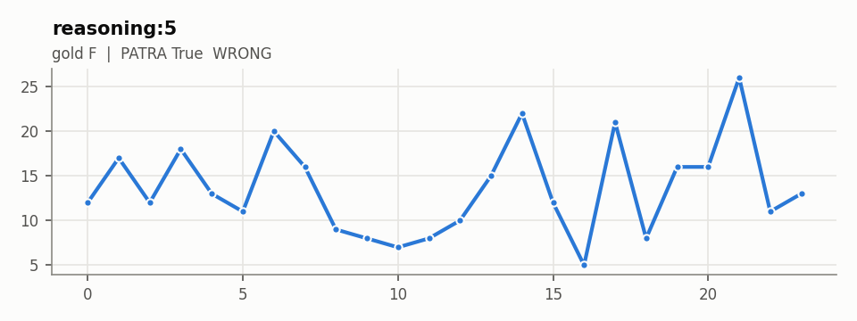

**Câu hỏi:** Given the data &lt;ts&gt;&lt;ts/&gt;, there is a general upward trend. True or False?

**Đáp án đúng:** F

**PATRA:** True (wrong)

**Câu trả lời đầy đủ của PATRA:** &lt;think&gt; The data shows an initial decrease followed by an increase, indicating a general upward trend. &lt;/think&gt; \boxed{True}

Độ biến động 1.19, độ dốc +0.07, tỷ lệ độ lệch chuẩn hai nửa 1.41. Chuỗi: 12, 17, 12, 18, 13, 11, 20, 16, 9, 8, 7, 8, 10, 15, 22, 12, 5, 21, 8, 16, 16, 26, 11, 13

## `reasoning:77` · có nhãn

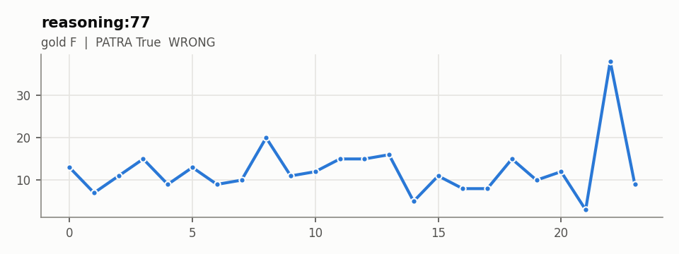

**Câu hỏi:** The data points &lt;ts&gt;&lt;ts/&gt; suggest an upward trend overall. True or false?

**Đáp án đúng:** F

**PATRA:** True (wrong)

**Câu trả lời đầy đủ của PATRA:** &lt;think&gt; The data shows a general increase from -0.49 to 0.38, indicating an upward trend. &lt;/think&gt; \boxed{True}

Độ biến động 1.07, độ dốc +0.12, tỷ lệ độ lệch chuẩn hai nửa 2.58. Chuỗi: 13, 7, 11, 15, 9, 13, 9, 10, 20, 11, 12, 15, 15, 16, 5, 11, 8, 8, 15, 10, 12, 3, 38, 9

## `reasoning:84` · có nhãn

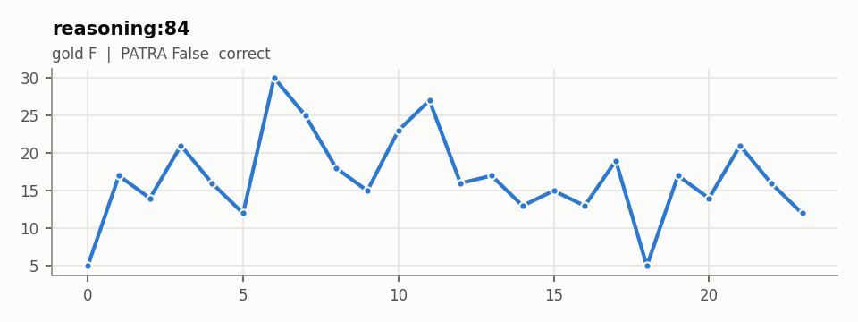

**Câu hỏi:** True or False: The data points &lt;ts&gt;&lt;ts/&gt; display a consistent upward trend.

**Đáp án đúng:** F

**PATRA:** False (correct)

**Câu trả lời đầy đủ của PATRA:** &lt;think&gt; The data shows fluctuations without a clear upward trend. It starts with a decrease, then increases slightly, and finally decreases again. &lt;/think&gt; \boxed{False}

Độ biến động 1.10, độ dốc -0.09, tỷ lệ độ lệch chuẩn hai nửa 1.73. Chuỗi: 5, 17, 14, 21, 16, 12, 30, 25, 18, 15, 23, 27, 16, 17, 13, 15, 13, 19, 5, 17, 14, 21, 16, 12

## `reasoning:91` · có nhãn

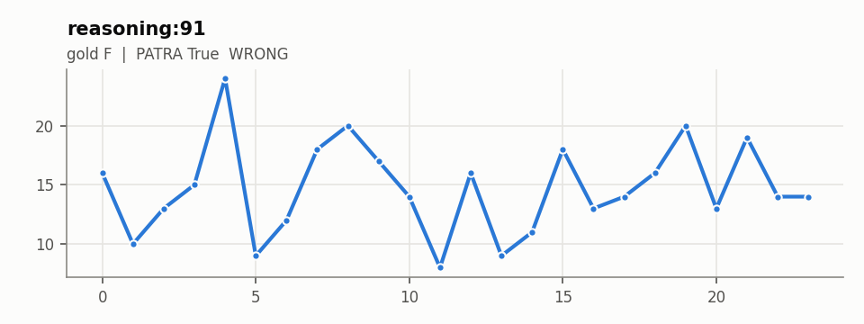

**Câu hỏi:** The subset &lt;ts&gt;&lt;ts/&gt; shows an increasing trend overall.

**Đáp án đúng:** F

**PATRA:** True (wrong)

**Câu trả lời đầy đủ của PATRA:** &lt;think&gt; The data points show a general upward trend from -0.49 to 0.38, indicating an overall increasing trend. &lt;/think&gt; \boxed{True}

Độ biến động 1.26, độ dốc +0.03, tỷ lệ độ lệch chuẩn hai nửa 1.46. Chuỗi: 16, 10, 13, 15, 24, 9, 12, 18, 20, 17, 14, 8, 16, 9, 11, 18, 13, 14, 16, 20, 13, 19, 14, 14

## `reasoning:99` · có nhãn

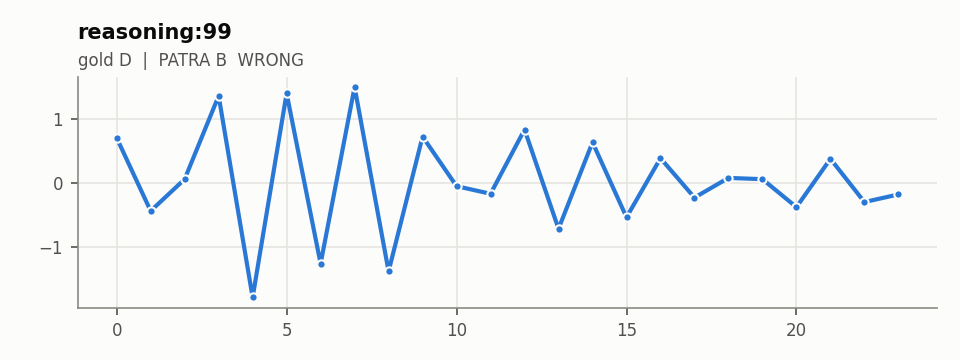

**Câu hỏi:** Examine the data points &lt;ts&gt;&lt;ts/&gt;. What is the main trend in this data? Options: A] Upward, B] Downward, C] No clear trend, D] Cyclical

**Đáp án đúng:** D

**PATRA:** B (wrong)

**Câu trả lời đầy đủ của PATRA:** &lt;think&gt;The data shows a general downward trend initially, followed by a slight upward movement towards the end. However, the overall trend is more downward than upward.&lt;/think&gt; \boxed{B}

Độ biến động 1.55, độ dốc -0.01, tỷ lệ độ lệch chuẩn hai nửa 2.36. Chuỗi: 0.71, -0.44, 0.06, 1.37, -1.8, 1.41, -1.27, 1.51, -1.39, 0.73, -0.05, -0.17, 0.84, -0.72, 0.64, -0.54, 0.39, -0.23, 0.08, 0.06, -0.38, 0.38, -0.3, -0.18

## `reasoning:114` · có nhãn

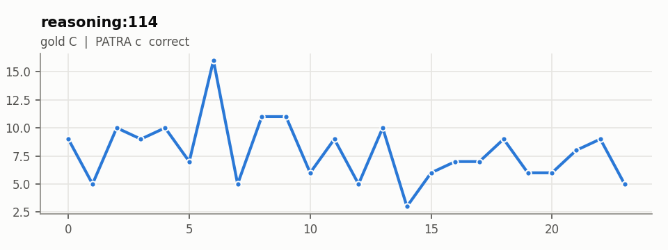

**Câu hỏi:** Which of the following best describes the trend in the series &lt;ts&gt;&lt;ts/&gt;? Options: a] Linear upwards, b] Linear downwards, c] No discernible trend, d] Cyclical

**Đáp án đúng:** C

**PATRA:** c (correct)

**Câu trả lời đầy đủ của PATRA:** &lt;think&gt;The series shows no clear upward or downward trend and does not exhibit cyclical patterns. It fluctuates without a consistent direction.&lt;/think&gt; \boxed{c}

Độ biến động 1.27, độ dốc -0.12, tỷ lệ độ lệch chuẩn hai nửa 1.53. Chuỗi: 9, 5, 10, 9, 10, 7, 16, 5, 11, 11, 6, 9, 5, 10, 3, 6, 7, 7, 9, 6, 6, 8, 9, 5

## `reasoning:174` · có nhãn

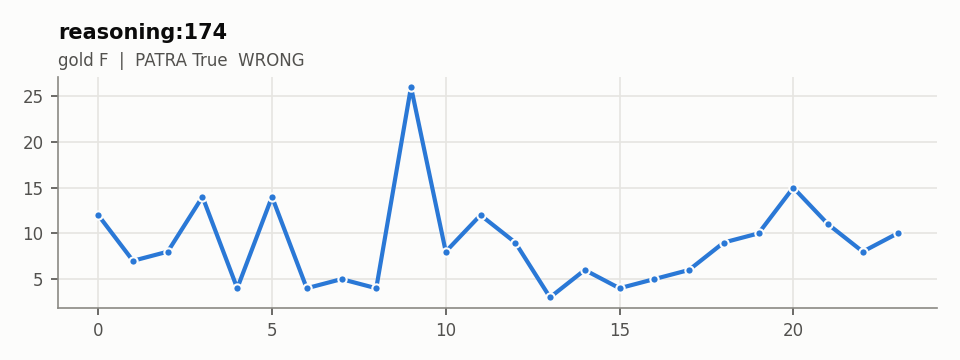

**Câu hỏi:** Is there an upward trend in the following series: &lt;ts&gt;&lt;ts/&gt;?

**Đáp án đúng:** F

**PATRA:** True (wrong)

**Câu trả lời đầy đủ của PATRA:** &lt;think&gt; The data shows a general increase from -0.49 to 0.38, indicating an upward trend. &lt;/think&gt; \boxed{True}

Độ biến động 1.07, độ dốc -0.01, tỷ lệ độ lệch chuẩn hai nửa 1.88. Chuỗi: 12, 7, 8, 14, 4, 14, 4, 5, 4, 26, 8, 12, 9, 3, 6, 4, 5, 6, 9, 10, 15, 11, 8, 10

## `reasoning:229` · có nhãn

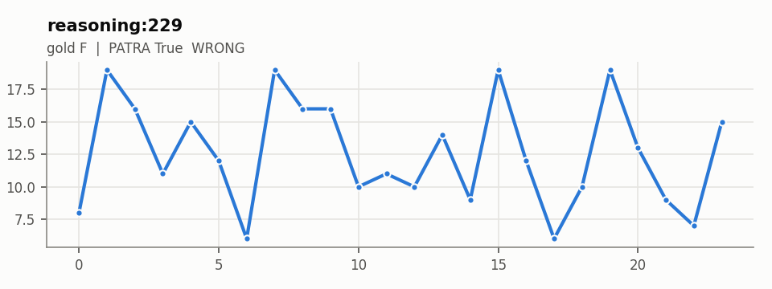

**Câu hỏi:** The data points &lt;ts&gt;&lt;ts/&gt; display an increasing trend overall. True or False?

**Đáp án đúng:** F

**PATRA:** True (wrong)

**Câu trả lời đầy đủ của PATRA:** &lt;think&gt; The data shows a general upward trend with some fluctuations, indicating an overall increasing trend. &lt;/think&gt; \boxed{True}

Độ biến động 1.28, độ dốc -0.10, tỷ lệ độ lệch chuẩn hai nửa 1.01. Chuỗi: 8, 19, 16, 11, 15, 12, 6, 19, 16, 16, 10, 11, 10, 14, 9, 19, 12, 6, 10, 19, 13, 9, 7, 15

## `reasoning:291` · có nhãn

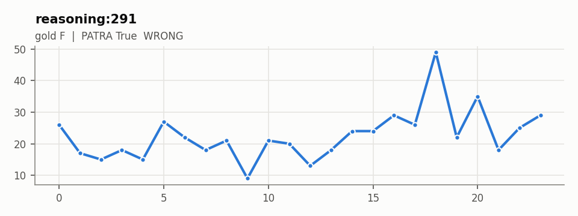

**Câu hỏi:** The data points &lt;ts&gt;&lt;ts/&gt; indicate an overall upwards trend.

**Đáp án đúng:** F

**PATRA:** True (wrong)

**Câu trả lời đầy đủ của PATRA:** &lt;think&gt; The data starts at -0.49 and ends at 0.38, showing a general increase over time. &lt;/think&gt; \boxed{True}

Độ biến động 1.00, độ dốc +0.52, tỷ lệ độ lệch chuẩn hai nửa 1.88. Chuỗi: 26, 17, 15, 18, 15, 27, 22, 18, 21, 9, 21, 20, 13, 18, 24, 24, 29, 26, 49, 22, 35, 18, 25, 29

## `reasoning:296` · có nhãn

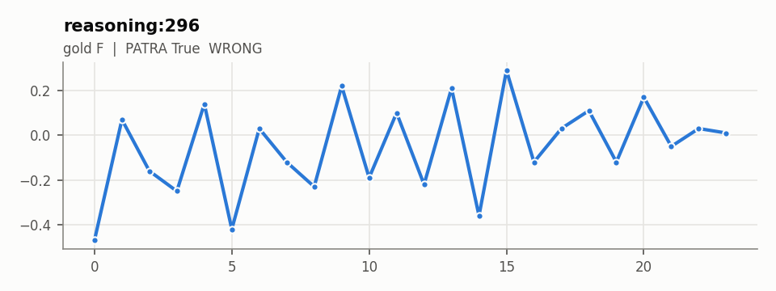

**Câu hỏi:** The data series &lt;ts&gt;&lt;ts/&gt; shows evidence of an upward trend.

**Đáp án đúng:** F

**PATRA:** True (wrong)

**Câu trả lời đầy đủ của PATRA:** &lt;think&gt; The data starts at -0.49 and gradually increases to 0.53, indicating an overall upward trend. &lt;/think&gt; \boxed{True}

Độ biến động 1.53, độ dốc +0.01, tỷ lệ độ lệch chuẩn hai nửa 1.19. Chuỗi: -0.47, 0.07, -0.16, -0.25, 0.14, -0.42, 0.03, -0.12, -0.23, 0.22, -0.19, 0.1, -0.22, 0.21, -0.36, 0.29, -0.12, 0.03, 0.11, -0.12, 0.17, -0.05, 0.03, 0.01

## `reasoning:364` · có nhãn

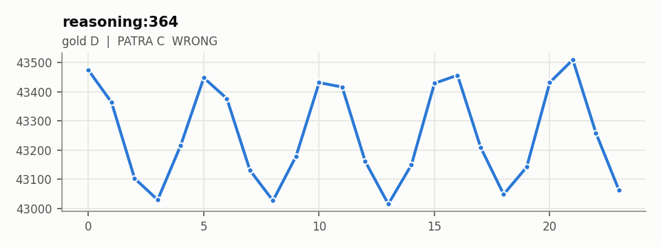

**Câu hỏi:** Which of the following best describes the overall direction for the data points &lt;ts&gt;&lt;ts/&gt;? A] Upward trend B] Downward trend C] No clear trend

**Đáp án đúng:** D

**PATRA:** C (wrong)

**Câu trả lời đầy đủ của PATRA:** &lt;think&gt;The data shows a downward trend initially but stabilizes and then slightly increases towards the end, indicating no clear overall trend.&lt;/think&gt; \boxed{C}

Độ biến động 1.02, độ dốc -0.50, tỷ lệ độ lệch chuẩn hai nửa 1.03. Chuỗi: 43473.8, 43363.7, 43103.1, 43029.7, 43216.6, 43447.9, 43376.5, 43131, 43027, 43178.9, 43431.4, 43416.2, 43160.9, 43015.2, 43149.4, 43428.8, 43456.7, 43209.8, 43048.5, 43142.1, 43431.8, 43509.8, 43258.9, 43062.6

## `reasoning:380` · có nhãn

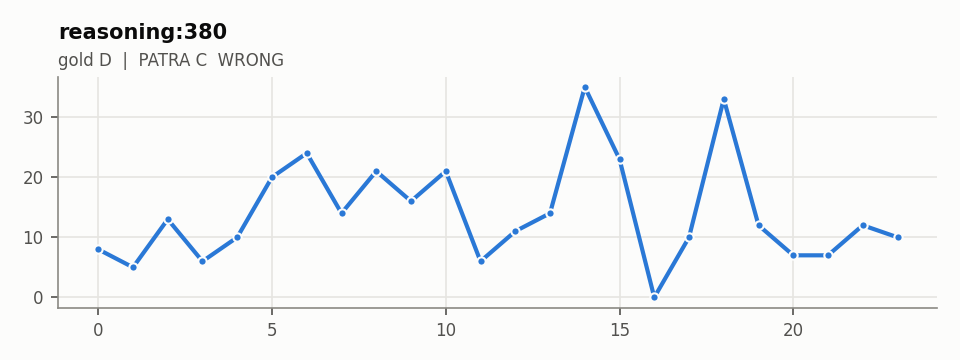

**Câu hỏi:** Consider the data points &lt;ts&gt;&lt;ts/&gt;. What is the general trend observed in these data points? A] Increasing B] Decreasing C] No clear trend D] Cyclical

**Đáp án đúng:** D

**PATRA:** C (wrong)

**Câu trả lời đầy đủ của PATRA:** &lt;think&gt;The data shows a general downward trend initially but stabilizes around -0.45 to -0.35, indicating no clear trend or cyclical pattern.&lt;/think&gt; \boxed{C}

Độ biến động 1.07, độ dốc +0.05, tỷ lệ độ lệch chuẩn hai nửa 1.57. Chuỗi: 8, 5, 13, 6, 10, 20, 24, 14, 21, 16, 21, 6, 11, 14, 35, 23, 0, 10, 33, 12, 7, 7, 12, 10

## `reasoning:383` · có nhãn

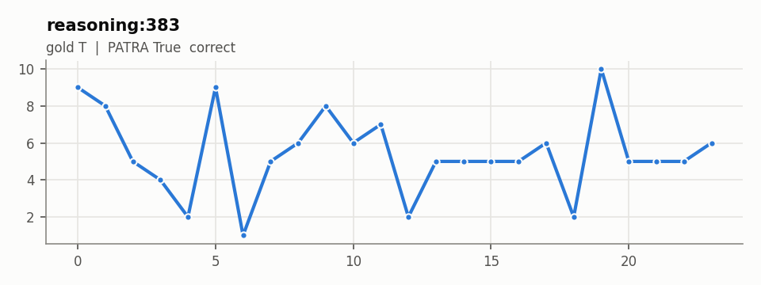

**Câu hỏi:** The trend for the series &lt;ts&gt;&lt;ts/&gt; is downward.

**Đáp án đúng:** T

**PATRA:** True (correct)

**Câu trả lời đầy đủ của PATRA:** &lt;think&gt; The series shows a general decrease from -0.49 to -0.53, indicating a downward trend. &lt;/think&gt; \boxed{True}

Độ biến động 1.14, độ dốc -0.03, tỷ lệ độ lệch chuẩn hai nửa 1.28. Chuỗi: 9, 8, 5, 4, 2, 9, 1, 5, 6, 8, 6, 7, 2, 5, 5, 5, 5, 6, 2, 10, 5, 5, 5, 6

## `reasoning:466` · có nhãn

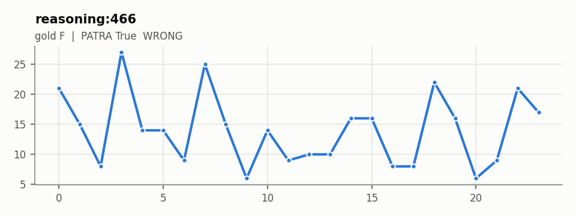

**Câu hỏi:** The data points &lt;ts&gt;&lt;ts/&gt; show an upward trend overall. True or False?

**Đáp án đúng:** F

**PATRA:** True (wrong)

**Câu trả lời đầy đủ của PATRA:** &lt;think&gt; The data shows a general increase from -0.49 to 0.37, indicating an upward trend overall. &lt;/think&gt; \boxed{True}

Độ biến động 1.21, độ dốc -0.13, tỷ lệ độ lệch chuẩn hai nửa 1.23. Chuỗi: 21, 15, 8, 27, 14, 14, 9, 25, 15, 6, 14, 9, 10, 10, 16, 16, 8, 8, 22, 16, 6, 9, 21, 17

## `reasoning:508` · có nhãn

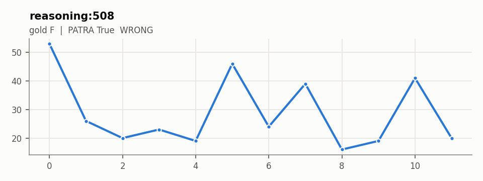

**Câu hỏi:** There is an increasing trend in the data set &lt;ts&gt;&lt;ts/&gt;.

**Đáp án đúng:** F

**PATRA:** True (wrong)

**Câu trả lời đầy đủ của PATRA:** &lt;think&gt; The data shows a general upward trend from -0.49 to 0.38, indicating an increasing trend. &lt;/think&gt; \boxed{True}

Độ biến động 1.32, độ dốc -0.81, tỷ lệ độ lệch chuẩn hai nửa 1.35. Chuỗi: 53, 26, 20, 23, 19, 46, 24, 39, 16, 19, 41, 20

## `reasoning:542` · có nhãn

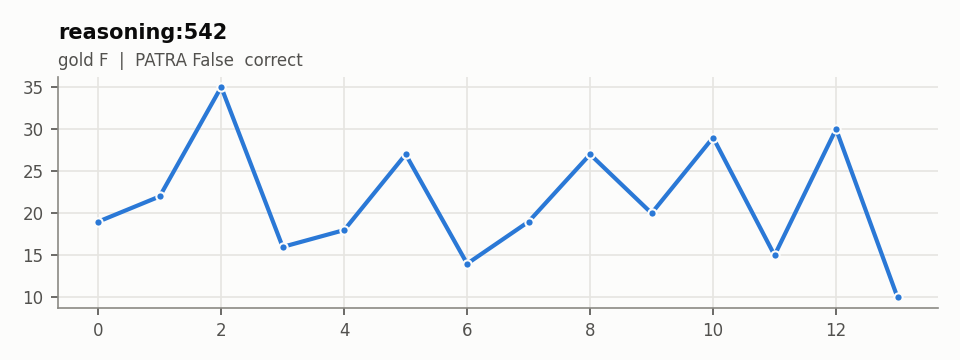

**Câu hỏi:** The data points &lt;ts&gt;&lt;ts/&gt; exhibit a clear upward trend. True or false?

**Đáp án đúng:** F

**PATRA:** False (correct)

**Câu trả lời đầy đủ của PATRA:** &lt;think&gt; The data shows an initial increase followed by a decrease and then another increase. There is no clear overall upward trend throughout the series. &lt;/think&gt; \boxed{False}

Độ biến động 1.54, độ dốc -0.23, tỷ lệ độ lệch chuẩn hai nửa 1.04. Chuỗi: 19, 22, 35, 16, 18, 27, 14, 19, 27, 20, 29, 15, 30, 10

## `reasoning:577` · có nhãn

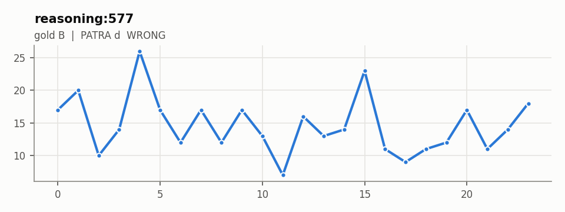

**Câu hỏi:** Examine the following time series data points &lt;ts&gt;&lt;ts/&gt;. What is the overall trend observed in this data? a] Increasing b] Decreasing c] Stable d] Cyclical

**Đáp án đúng:** B

**PATRA:** d (wrong)

**Câu trả lời đầy đủ của PATRA:** &lt;think&gt;The data shows an initial increase followed by a decrease, indicating a cyclical trend rather than a consistent increase or decrease.&lt;/think&gt; \boxed{d}

Độ biến động 1.26, độ dốc -0.15, tỷ lệ độ lệch chuẩn hai nửa 1.28. Chuỗi: 17, 20, 10, 14, 26, 17, 12, 17, 12, 17, 13, 7, 16, 13, 14, 23, 11, 9, 11, 12, 17, 11, 14, 18

## `reasoning:614` · có nhãn

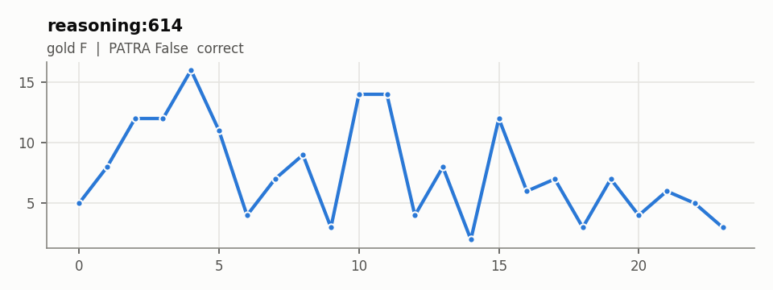

**Câu hỏi:** The data points &lt;ts&gt;&lt;ts/&gt; demonstrate a decreasing trend. True or False?

**Đáp án đúng:** F

**PATRA:** False (correct)

**Câu trả lời đầy đủ của PATRA:** &lt;think&gt; The data shows an initial increase followed by a decrease, indicating a trend change from increasing to decreasing. &lt;/think&gt; \boxed{False}

Độ biến động 1.07, độ dốc -0.25, tỷ lệ độ lệch chuẩn hai nửa 1.55. Chuỗi: 5, 8, 12, 12, 16, 11, 4, 7, 9, 3, 14, 14, 4, 8, 2, 12, 6, 7, 3, 7, 4, 6, 5, 3

## `reasoning:615` · có nhãn

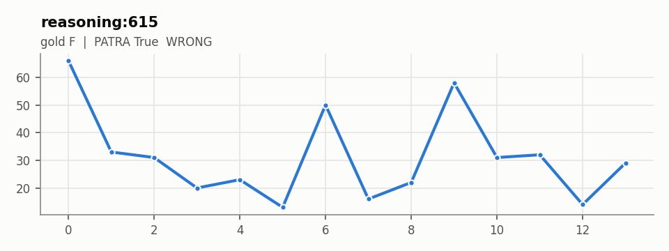

**Câu hỏi:** The time series data &lt;ts&gt;&lt;ts/&gt; shows an overall decreasing trend. True or False?

**Đáp án đúng:** F

**PATRA:** True (wrong)

**Câu trả lời đầy đủ của PATRA:** &lt;think&gt; The data starts at 0.5 and generally decreases to -0.49, indicating an overall decreasing trend. &lt;/think&gt; \boxed{True}

Độ biến động 1.15, độ dốc -0.96, tỷ lệ độ lệch chuẩn hai nửa 1.26. Chuỗi: 66, 33, 31, 20, 23, 13, 50, 16, 22, 58, 31, 32, 14, 29

## `reasoning:696` · có nhãn

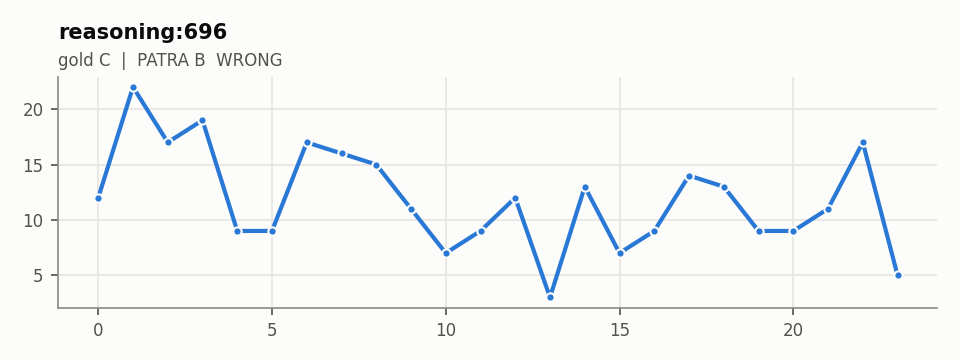

**Câu hỏi:** What is the predominant trend in the data series &lt;ts&gt;&lt;ts/&gt;? A] Increasing B] Decreasing C] Stable D] Cyclical

**Đáp án đúng:** C

**PATRA:** B (wrong)

**Câu trả lời đầy đủ của PATRA:** &lt;think&gt;The data shows a general upward trend initially but stabilizes around the middle before declining slightly at the end, indicating no clear cyclical pattern.&lt;/think&gt; \boxed{B}

Độ biến động 1.03, độ dốc -0.28, tỷ lệ độ lệch chuẩn hai nửa 1.19. Chuỗi: 12, 22, 17, 19, 9, 9, 17, 16, 15, 11, 7, 9, 12, 3, 13, 7, 9, 14, 13, 9, 9, 11, 17, 5

## `comprehension:89` · câu mở

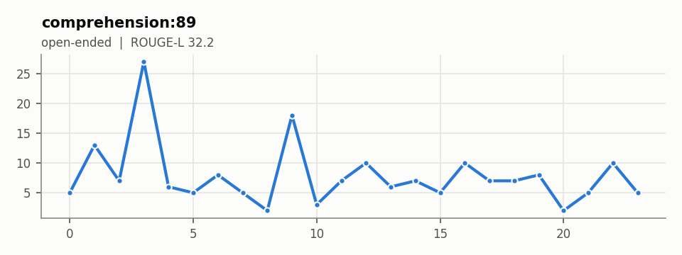

**Câu hỏi:** Given the time series data points &lt;ts&gt;&lt;ts/&gt;, summarize the overall movement trend.

**Đáp án đúng:** The data appears to have erratic fluctuations with no clear trend. It starts with moderate values, spikes to a high at 27.0, then fluctuates with small ups and downs, ending at a moderate value. This indicates a lack of consistent trend and significant variability in the series.

**PATRA:** The overall trend shows an initial increase followed by a decrease. The data starts with a rise from -0.49 to 0.31 and then declines back towards negative values, indicating a peak and subsequent decline in the series.

Độ biến động 1.14, độ dốc -0.20, tỷ lệ độ lệch chuẩn hai nửa 2.95. Chuỗi: 5, 13, 7, 27, 6, 5, 8, 5, 2, 18, 3, 7, 10, 6, 7, 5, 10, 7, 7, 8, 2, 5, 10, 5

## `reasoning:305` · câu mở

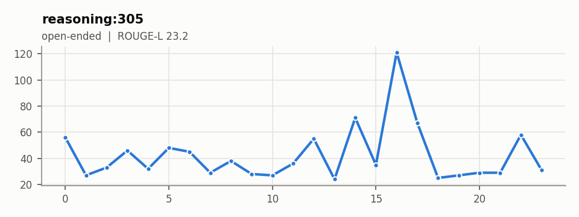

**Câu hỏi:** Analyze the trend in the time series data points: &lt;ts&gt;&lt;ts/&gt;. What overall trend can you observe?

**Đáp án đúng:** The time series data shows a cyclical pattern with some high peaks such as 121.0 and 71.0, indicating variability and possible external influences causing these spikes. Overall, there is no consistent upward or downward trend, as the data oscillates around a central tendency.

**PATRA:** The data shows an initial upward trend followed by a downward trend. Initially, the values increase from -0.29 to 0.41, indicating growth. However, after reaching a peak at 0.41, the values start decreasing, showing a decline. This suggests an overall upward trend followed by a downward trend.

Độ biến động 1.03, độ dốc +0.27, tỷ lệ độ lệch chuẩn hai nửa 2.99. Chuỗi: 56, 27, 33, 46, 32, 48, 45, 29, 38, 28, 27, 36, 55, 24, 71, 35, 121, 67, 25, 27, 29, 29, 58, 31

## `comprehension:291` · câu mở

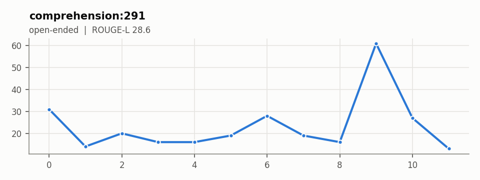

**Câu hỏi:** Examine and summarize the movement in the points &lt;ts&gt;&lt;ts/&gt;.

**Đáp án đúng:** The initial data shows minor fluctuations, leading to a drastic increase towards the end with the peak value at 61.0, after which it decreases again. This shows a generally stable trend with a sudden peak.

**PATRA:** The data shows an initial increase followed by a decrease, indicating a peak at 14.0 before declining to lower values. The series starts with a rise, peaking around 14.0, then declines steadily.

Độ biến động 1.04, độ dốc +0.78, tỷ lệ độ lệch chuẩn hai nửa 2.86. Chuỗi: 31, 14, 20, 16, 16, 19, 28, 19, 16, 61, 27, 13

